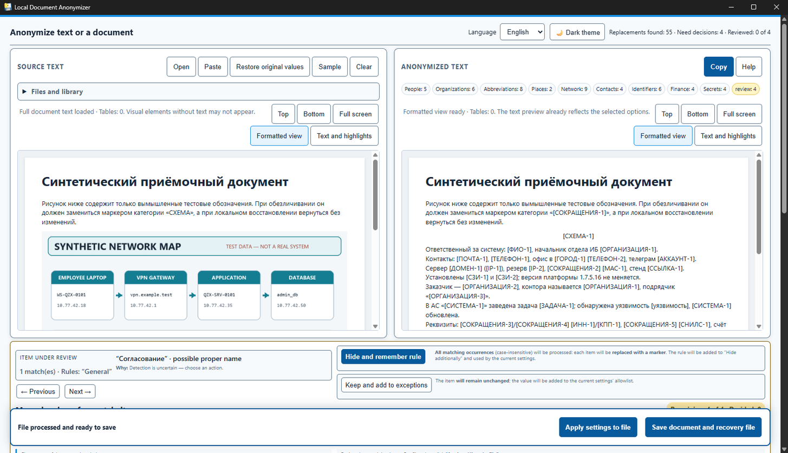
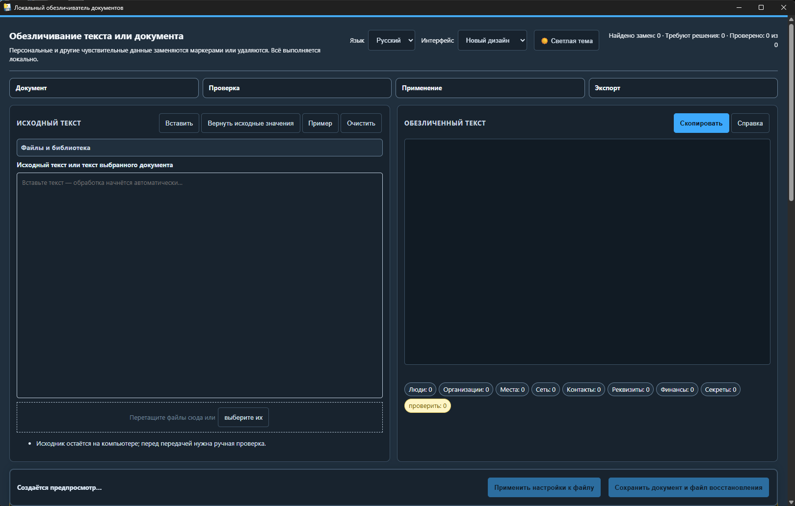

# Local Document Anonymizer

A fully local desktop application for anonymizing `.docx`, `.doc`, `.odt`, `.xlsx`, `.txt`, `.csv`, `.md`, and `.log` files. The interface is available in English and Russian. The application does not use a network server, HTTP requests, CDNs, telemetry, or cloud models.

## Screenshots

### English interface



*Current UI from `main` in a clean empty state. The screenshot is generated locally from the bundled HTML/CSS at 1600×1000 and contains no user document, personal data, or confidential values.*

### Russian interface



*Текущий интерфейс из `main` в чистом пустом состоянии. Скриншот локально сформирован из включённых в приложение HTML/CSS при размере 1600×1000 и не содержит пользовательских документов, персональных или конфиденциальных значений.*

## Ready-to-use Windows build

1. Download `LocalAnonymizer-0.2.8-windows-x64.zip` from [Releases](https://github.com/onv83/LocalAnonymizer/releases/latest).
2. Extract the complete archive.
3. Run `LocalAnonymizer\LocalAnonymizer.exe`.

The packaged application does not require Python, `uv`, pip, or manually installed Python packages. Keep the `_internal` directory next to the executable. Windows 11 uses the system Microsoft Edge WebView2 runtime.

> **Version status:** `v0.2.8` is the current verified Windows release. The changes listed below are available on `main` and are being prepared for `v0.2.9`; native Linux and macOS packages are not published or declared supported yet.

## Changes on `main` since `v0.2.8`

- Added native Linux/macOS CI and packaged smoke gates, including fail-closed checks for secure storage and clipboard integration. Windows remains the primary supported platform, and the existing Word COM path for high-fidelity DOC/DOCX handling is unchanged.
- Packaged builds now include the runtime `python-docx` templates required for DOCX creation and export.
- Moved the manual-review workspace below the two preview panes, compacted its actions, collapsed optional modes, and kept the apply panel visible while reviewing.
- Reworked the document workspace: `Open` is in the source header, the mapping chips sit above the anonymized preview, both previews are larger, and the redundant workflow strip, subtitle, source label, storage notice, and visible drop hint were removed. Window-level drag-and-drop remains available.
- Increased the preferred Windows launch width to 1600 px while clamping it to the available screen, improved low-height layouts, and aligned the Russian and English interfaces in light and dark themes.
- The formatted-preview toolbar now appears immediately while rendering, reserves its final position, reports that the view is being prepared, and enables formatted-only controls when ready.
- Clearing a formatted document now removes both formatted-preview hosts before restoring the empty text panes, preventing a stale blank panel.
- Rewrote the built-in English and Russian usage guide for the current preview, review, apply, export, and portable `.larecovery` workflow.
- Improved anonymization of explicitly labelled postal addresses and five- or six-digit postal indexes while retaining negative checks for unrelated numbers.
- Added a separate reversible `ПОРТ` / Port category: values from 1 through 65535 are anonymized after an explicit `порт`/`port` label, in ranges, TCP/UDP forms, and network endpoints such as `IP:port`, `domain:port`, `[IPv6]:port`, and infrastructure `host:port`. Bare numbers, times, versions, invalid values, and numeric credentials are not treated as ports; a URL containing a port remains one link marker.
- Added a separate `СОКРАЩЕНИЯ` / Abbreviations category: complete two-letter uppercase Unicode tokens are redacted from their first occurrence, while tokens with at least three consecutive uppercase letters remain supported. Domains concatenated by Word with table-of-contents page numbers are fully redacted while the page number is preserved.
- Compound policy/task identifiers with multiple uppercase code fields are now replaced as one bounded `СОКРАЩЕНИЯ` marker, including numeric dotted version fragments, split DOCX runs and intra-cell hard breaks; email, URL, filesystem and dotted-hostname contexts remain excluded.
- Contextual and inventory addresses are grouped into one bounded `АДРЕС` marker, including postfix street types, ordinal names, building qualifiers, and DOCX split runs without consuming adjacent prose.
- Location tables with paired `Название`/`Адрес` semantics now redact both the bounded site-name cell and its complete address cell. Hyphenated `пр-кт` and an optional parenthetical `проспект` expansion are supported without using a dictionary of individual regions.
- Server names split by a hard break or paragraph boundary inside one DOCX inventory cell are grouped into one `УЗЕЛ` marker; in semantic server-capacity tables, the complete bounded node-name cell is redacted after the headings and row IP confirm its role, without relying on a fixed role-code dictionary. Unrelated prose and neighbouring cells are not joined.
- Bounded service-account names, including assignments with internal underscores, are emitted as one `ЛОГИН` marker, and four-column inventory rows now cover administrative area, district abbreviation, city/branch, and full address with semantic precedence over abbreviations.
- Both manual-review decisions are grouped under the anonymized side, with hover help retained and the permanent completion hint removed from the visible layout.
- Dictionary-setting tabs in both languages now show a right-facing arrow while preserving the active state, keyboard tab behavior and accessible text labels.
- On narrow screens the file-library controls collapse to one bounded column, so select/import/export/delete controls stay inside the viewport.
- Equal DOCX location values with different hard-break topology keep separate reversible identities during edited-package restoration.
- Embedded DOCX images and static diagrams are removed from the anonymized copy with a visible `[СХЕМА-N]` marker and restored exactly on the local computer; the public screenshots show the current clean UI without user data.
- Added and expanded regression coverage for layout, localization parity, address/index detection, formatted-preview loading and clearing, packaging, secure storage, and native platform smoke checks.

See [CHANGELOG.md](CHANGELOG.md) for the version history in English and Russian.

## Highlights

- Reversible anonymization with encrypted local mappings and portable recovery files.
- DOCX formatting is preserved by OOXML-aware processing; legacy DOC conversion uses Microsoft Word COM on Windows.
- Local formatted, read-only DOCX preview and text review workflow.
- Support for DOCX, legacy DOC on Windows, ODT, XLSX, and text-based formats.
- English and Russian interfaces with persistent language selection.
- No cloud processing: document content remains on the local computer.

## Platform status

Windows is the reference environment for `.doc` and `.docx` fidelity. Legacy `.doc` conversion uses Microsoft Word COM and is not presented as equivalent on other operating systems.

Cross-platform foundations are included for Linux and macOS: native data directories, fail-closed AES-GCM storage backed by the system keyring, native clipboard adapters, an ODT processor, a shared PyInstaller specification, and target-OS verification scripts. These paths still require native GUI, keyring, clipboard, packaging, and recovery testing before Linux or macOS releases can be considered supported.

Build and verify native packages on the target operating system:

```sh
./build.sh
./verify-native.sh
```

PyInstaller cross-building is not used. Linux produces `dist/LocalAnonymizer/LocalAnonymizer`; macOS produces `dist/LocalAnonymizer.app`. Successful CLI smoke tests do not replace a manual GTK/WebKit or Cocoa GUI check.

## Security notes

- Processing is local, and source values are not written to application logs.
- Windows mappings and profiles are protected with DPAPI for the current user.
- Non-Windows storage fails closed when a suitable system keyring is unavailable; there is no plaintext fallback.
- Exported `.larecovery` files intentionally contain original values and must be protected like the source document.
- Anonymized output still requires final manual review.

## Development

Use Python 3.11 and `uv`:

```bat
uv sync --extra dev --no-install-project
uv run --no-project python -m pytest -q
build.bat
```

For the detailed workflow, limitations, engine coverage, and security model, see the Russian documentation below.

---

# Локальный обезличиватель документов

Приложение для локального обезличивания `.docx`, `.doc`, `.odt`, `.xlsx`, `.txt`, `.csv`, `.md` и `.log`. Интерфейс переключается между русским и английским языками с сохранением выбора. Текущий проверенный готовый выпуск предназначен для Windows. Сетевой сервер, HTTP-запросы, CDN, телеметрия и облачные модели не используются.

## Скриншоты

### Интерфейс на русском языке


*Текущий интерфейс из `main` в чистом пустом состоянии. Скриншот локально сформирован из включённых в приложение HTML/CSS при размере 1600×1000 и не содержит пользовательских документов, персональных или конфиденциальных значений.*

### Интерфейс на английском языке


*Current UI from `main` in a clean empty state. The screenshot is generated locally from the bundled HTML/CSS at 1600×1000 and contains no user document, personal data, or confidential values.*

## Запуск готовой версии — без Python и установки пакетов

1. Скачайте архив `LocalAnonymizer-0.2.8-windows-x64.zip` из раздела [Releases](https://github.com/onv83/LocalAnonymizer/releases/latest).
2. Распакуйте архив в обычную папку.
3. Запустите `LocalAnonymizer\LocalAnonymizer.exe`.

Python, `uv`, pip и установка зависимостей для готовой версии **не нужны**. Папку `_internal` рядом с `.exe` нельзя удалять или переносить отдельно: в ней уже находятся Python и все необходимые библиотеки приложения. На Windows 11 используется системный Microsoft Edge WebView2.

> **Статус версии:** `v0.2.8` — текущий проверенный выпуск для Windows. Перечисленные ниже изменения уже находятся в `main` и готовятся для `v0.2.9`; нативные пакеты Linux и macOS пока не опубликованы и не объявлены поддерживаемыми.

## Изменения в `main` по сравнению с `v0.2.8`

- Добавлены нативные CI-сборки Linux/macOS и проверки готовых пакетов, включая fail-closed-проверки защищённого хранилища и буфера обмена. Windows остаётся основной поддерживаемой платформой, существующий Word COM-конвейер точной обработки DOC/DOCX не изменён.
- В готовые сборки включены служебные шаблоны `python-docx`, необходимые для создания и экспорта DOCX.
- Блок ручной проверки перенесён под две панели предпросмотра, его действия уплотнены, дополнительные режимы свёрнуты, а панель применения остаётся видимой во время проверки.
- Рабочая область документа перестроена: `Открыть` находится в заголовке исходного документа, маркеры соответствий — над обезличенным предпросмотром, обе области предпросмотра увеличены. Удалены лишняя полоса этапов, подзаголовок, подпись исходного редактора, статическое уведомление о хранении и видимая drop-подсказка; перетаскивание файла в окно продолжает работать.
- Предпочтительная ширина окна Windows увеличена до 1600 пикселей с ограничением по доступному экрану, улучшена компоновка при небольшой высоте, русская и английская версии согласованы в светлой и тёмной темах.
- Панель форматированного предпросмотра появляется сразу после начала подготовки, заранее занимает итоговое место, сообщает о загрузке и включает доступные только после готовности команды автоматически.
- После очистки форматированного документа обе области форматированного предпросмотра удаляются до возврата пустых текстовых панелей, поэтому лишняя пустая панель больше не остаётся.
- Встроенная инструкция на русском и английском переписана под актуальный процесс предпросмотра, проверки, применения, экспорта и переносимых файлов `.larecovery`.
- Улучшено обезличивание явно подписанных почтовых адресов и пяти- или шестизначных индексов; посторонние числа по-прежнему не считаются индексами.
- Добавлена отдельная обратимая категория `ПОРТ`: номера от 1 до 65535 обезличиваются после явной подписи `порт`/`port`, в диапазонах, обозначениях `TCP`/`UDP` и сетевых конечных точках `IP:порт`, `домен:порт`, `[IPv6]:порт` и инфраструктурный `узел:порт`. Голые числа, время, версии, недопустимые номера и цифровые учётные данные не считаются портами; ссылка с портом остаётся одним маркером ссылки.
- Добавлена отдельная категория `СОКРАЩЕНИЯ`: полные двухбуквенные токены из заглавных Unicode-букв скрываются уже при первом вхождении, а токены минимум с тремя подряд заглавными буквами остаются поддержанными; домены, склеенные Word с номерами страниц оглавления, заменяются целиком с сохранением номера страницы.
- Контекстные и инвентарные адреса объединяются в один ограниченный маркер `АДРЕС`, включая тип улицы после названия, порядковые названия, реквизиты строения и разрывы runs DOCX без захвата соседнего текста.
- Серверное имя с жёстким переносом или границей абзаца внутри одной инвентарной ячейки DOCX объединяется в один маркер `УЗЕЛ`; в семантической таблице серверных мощностей целиком скрывается bounded-значение ячейки имени узла после подтверждения роли заголовками и IP той же строки, без фиксированного словаря кодов ролей. Обычный текст и соседние ячейки не склеиваются.
- Ограниченные имена сервисных учётных записей заменяются одним маркером `ЛОГИН`, а четырёхколоночные инвентарные строки покрывают регион, сокращение округа, город/филиал и полный адрес с приоритетом точных сущностей над сокращениями.
- Обе кнопки решения ручной проверки собраны под правой панелью обезличенного текста; hover-подсказки сохранены, постоянная инструкция по завершению скрыта из видимой компоновки.
- Встроенные рисунки и статические схемы DOCX удаляются из обезличенной копии с видимым маркером `[СХЕМА-N]` и точно восстанавливаются локально; публичные скриншоты показывают актуальный чистый интерфейс без пользовательских данных.
- Расширены регрессионные проверки компоновки, эквивалентности локализаций, адресов и индексов, загрузки и очистки форматированного предпросмотра, упаковки, защищённого хранилища и нативных platform smoke checks.

История версий на русском и английском языках ведётся в [CHANGELOG.md](CHANGELOG.md).

## Запуск из исходного кода (только для разработки)

1. Установите Python 3.11 и `uv`.
2. В каталоге проекта выполните:
   ```bat
   uv sync --extra dev --no-install-project
   run.bat
   ```
3. Быстрая проверка без открытия окна: `run.bat --smoke`.

После сборки `run.bat` запускает `dist\LocalAnonymizer\LocalAnonymizer.exe`. Локальная проверенная копия сборки может храниться в `release\LocalAnonymizer`, но каталог `release` намеренно не публикуется в Git: готовая версия распространяется архивом через GitHub Releases.

## Платформенная архитектура

Предметное ядро, DOCX/XLSX и текстовые форматы не зависят от Windows. Платформенные функции вынесены за отдельные границы:

- каталог данных выбирается по правилам `%LOCALAPPDATA%`, XDG или `~/Library/Application Support`;
- Windows DPAPI и системный буфер обмена подключаются через адаптеры;
- конвертер старого `.doc` передаётся сервису как отдельная зависимость; штатный Windows-адаптер по-прежнему использует Microsoft Word COM;
- PyInstaller использует единый `LocalAnonymizer.spec`; `build.bat` и `build.sh` являются только платформенными оболочками над ним;
- GUI-зависимости ограничены маркерами платформы: WebView2 на Windows, Cocoa на macOS и GTK/WebKit на Linux.

Linux/macOS-сборки пока не публикуются и не считаются поддерживаемыми. Нативные GitHub Actions уже проверяют сборку, запуск, системное защищённое хранилище и clipboard backend на Ubuntu и macOS, однако интерактивная работа GUI, интеграция с реальными desktop keyring и полный пользовательский цикл восстановления ещё требуют ручной проверки на целевых ОС. Открытого fallback для локальных карт замен нет. Экспортируемый переносимый `.larecovery`, напротив, намеренно не зашифрован, содержит исходные значения и предупреждение о чувствительных данных; его нужно защищать так же, как оригинал.

Подготовка нативных пакетов выполняется **на соответствующей ОС** (кросс-сборка PyInstaller не используется):

```sh
./build.sh
./verify-native.sh
```

На Linux создаётся `dist/LocalAnonymizer/LocalAnonymizer`, на macOS — нативный bundle `dist/LocalAnonymizer.app`. Проверяющий скрипт запускает core smoke, восстановление пары файлов и новый `--platform-smoke`: реальный round-trip защищённого хранилища и наличие нативного clipboard backend без чтения или перезаписи пользовательского буфера. Успех этих CLI-проверок ещё не заменяет ручной GUI-smoke GTK/WebKit или Cocoa.

## Работа

1. Вставьте текст либо выберите/перетащите файл. Текст анализируется автоматически с небольшой задержкой. Для DOCX левая панель по умолчанию показывает локальный форматированный read-only предпросмотр (порядок абзацев/таблиц, заголовки, базовое форматирование и колонтитулы); переключатель **«Текст и подсветка»** открывает обычный текстовый анализ. Для других форматов сохраняется текстовый предпросмотр.
2. Просмотрите синие обратимые замены, серые необратимые удаления и жёлтые подсказки. Стрелки переходят по всем отметкам; строка таблицы соответствий ведёт к маркеру.
3. Для жёлтой подсказки выберите **Оставить** или **Скрыть**. Щелчок по синему маркеру возвращает значение только в текущем тексте; решение можно отменить chip-кнопкой. Для файла после решений снова нажмите **Обезличить**, чтобы применить временные правила к выходному файлу.
4. Экспортируйте обезличенный файл либо все готовые файлы одним ZIP без mappings. CSV карты экспортируйте только после явного предупреждения: он содержит чувствительные значения.
5. Для DOCX workflow такой: скачайте обезличенный файл, отредактируйте его в Word без удаления служебного свойства, нажмите **«Восстановить исправленный файл…»**, выберите этот файл и затем место сохранения восстановленной копии. Новые правки, таблицы и форматирование сохраняются. Файл должен сохранить служебную привязку к операции (OPC `identifier` для DOCX/XLSX или служебную строку для текстовых форматов); чужой, старый либо лишённый привязки файл отклоняется до создания результата. Неизвестные маркеры сохраняются и перечисляются; необратимо удалённые секреты не восстанавливаются.

Оригиналы копируются в `%LOCALAPPDATA%\LocalAnonymizer\documents`. Метаданные библиотеки находятся в SQLite. Карта каждого документа и профили зашифрованы Windows DPAPI для текущего пользователя и привязаны к идентификатору документа и операции.

## Настройки словаря

Строка `фраза` создаёт категорию `СЛОВАРЬ`; строка `фраза => МЕТКА` задаёт категорию. Названия меток могут содержать буквы, цифры, `_` и `-`; один формат маркеров используется в тексте, DOCX и XLSX. Правила регистронезависимы и учитывают границы слов. Белый список исключает точные значения. JSON-профили имеют версию и проходят проверку; исполняемого содержимого нет.

Секреты нельзя отключить или добавить в белый список. Метки `SECRET`, `СЕКРЕТ`, `ПАРОЛЬ`, `TOKEN`, `ТОКЕН` и `КЛЮЧ` в пользовательском словаре также выполняют необратимое удаление и не создают mapping.

## Покрытие движка

Движок распознаёт контекстные секреты и токены, ФИО/инициалы и устойчивые псевдонимы, организации с ОПФ и отдельные системы, логины, обычную и обфусцированную почту, международные телефоны, сетевые узлы и порты, реквизиты и коммерческие суммы. Версии и голые числа не считаются портами без сетевого контекста. Результат API содержит части замен/подсказок с исходными offsets, категорийные counts, общее число срабатываний и размер легенды; plaintext необратимых секретов в этих структурах отсутствует.

## Сборка и тесты

```bat
uv run --no-project python -m pytest -q
build.bat
uv run --no-project python scripts\e2e_smoke.py
```

Однопапочная сборка появляется в `dist\LocalAnonymizer`.

## Модель безопасности

- Выполнение полностью локальное; исходные значения не записываются в журнал.
- DPAPI не защищает от компрометации текущей учётной записи Windows или администратора.
- Скопированные оригиналы и восстановленные документы остаются чувствительными.
- Надёжное стирание на SSD не гарантируется.
- Новый результат пишется в operation-specific файл; output, DPAPI mapping, operation ID и статус переключаются одной SQLite-транзакцией. При сбое сохраняется предыдущая согласованная пара. Удаление ограничено каталогом приложения и не удаляет пользовательский источник.
- CSV нейтрализует значения, начинающиеся с `=`, `+`, `-`, `@`, но всё равно является чувствительным.
- `.doc` открывается Word только для чтения с отключёнными макросами, уведомлениями и обновлением ссылок.
- Форматированный DOCX preview строится локально только из фиксированного HTML allowlist. Текст проходит HTML escaping; hyperlink targets, изображения, произвольные Word style names/атрибуты и URL не сериализуются. Размер шрифта ограничен диапазоном 8–72 pt, цвет принимается только как шестизначный RGB.
- В DOCX обрабатываются видимые `w:t`, включая hyperlink/content-control runs; удаляются комментарии, свойства, внешние связи, удалённый tracked-change текст и скрытые runs; вставленный tracked-change текст принимается.
- Для настоящих footnotes/endnotes, текстовых блоков, document variables, изображений, custom XML, диаграмм, embedded objects и другого неподдерживаемого содержимого DOCX результат получает статус **«Требуется ручная проверка»**. Потенциально скрытые либо неподдерживаемые части, включая изображения, удаляются из публикуемой копии вместе со связанными relationships и Content Types; безопасные пустые служебные note-separator parts Word пересоздаются в каноническом виде.
- XLSX очищает комментарии, свойства, hyperlink targets, колонтитулы, сообщения data validation, defined names и внешние части. Чувствительные строковые литералы внутри формул обезличиваются; network/DDE/external-workbook формулы необратимо блокируются и запрещают экспорт. Обычные формулы без чувствительных данных сохраняются. Подписанные числовые реквизиты в соседних ячейках анализируются без изменения стилей и структуры.
- Признаки гостайны переводят документ в статус **«Экспорт запрещён»**. Обычные warnings требуют явного подтверждения для одиночного экспорта и не попадают в пакетный ZIP, пока статус не станет **«Готов»**.

## Ограничения MVP

Детерминированные правила консервативны и не дают качества полноценной NER/ML-модели. Неоднозначные короткие имена, нетипичные реквизиты и текст внутри сложных OOXML-объектов могут быть пропущены. Варианты ФИО объединяются под одним маркером только при достаточно сильных признаках общей идентичности, например при совпадении полного ФИО с формой «инициалы + фамилия». Отдельная или падежная форма фамилии без такого подтверждения получает собственный обратимый маркер. Для подтверждённых сокращённых вариантов, объединённых с полным ФИО, восстановление использует сохранённую опорную форму, поэтому исходная грамматическая форма такого варианта может не сохраниться. CSV обрабатывается как текст, а не как семантическая таблица. `.xls`, `.xlsm`, PDF и OCR изображений не поддерживаются. Drag-and-drop зависит от передачи локального пути движком WebView2; кнопка выбора файла является надёжным вариантом.

**Финальная ручная проверка каждого обезличенного документа обязательна.**
