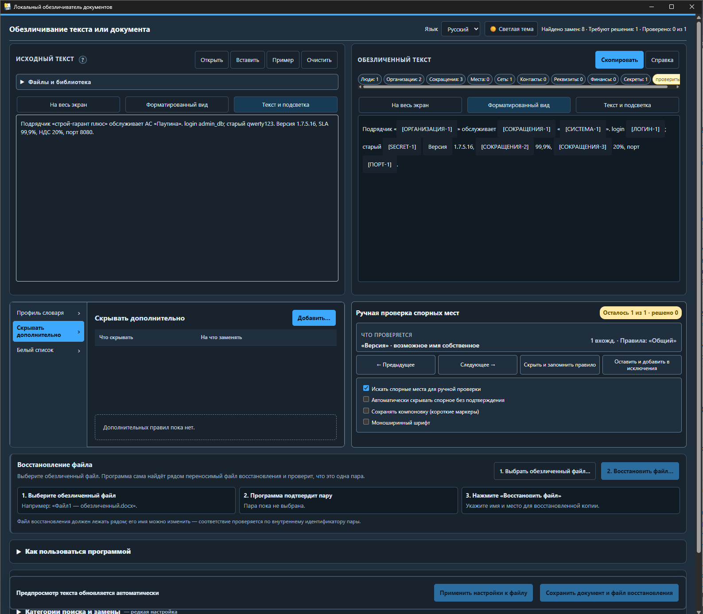
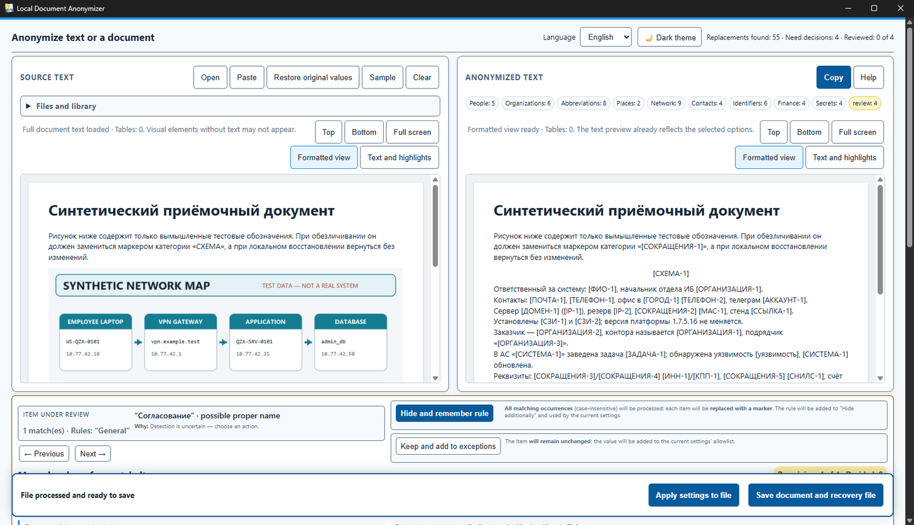

# LocalAnonymizer — локальный обезличиватель документов

Приложение обрабатывает документы на вашем компьютере, без облака, телеметрии, HTTP-сервера и передачи содержимого наружу. Интерфейс — русский и английский. Поддерживаются DOCX, ODT, XLSX, TXT, CSV, MD, LOG; старый DOC — только на Windows с Microsoft Word.

## Скачать v0.4.0 — Python не нужен

| Платформа | Скачать готовое приложение | Статус |
| --- | --- | --- |
| Windows x64 | [LocalAnonymizer-0.4.0-windows-x64.zip](https://github.com/onv83/LocalAnonymizer/releases/download/v0.4.0/LocalAnonymizer-0.4.0-windows-x64.zip) | Будет опубликован после завершения сборки и проверок |
| macOS Apple Silicon (ARM64, M-серия) | [LocalAnonymizer-0.4.0-macos-arm64.zip](https://github.com/onv83/LocalAnonymizer/releases/download/v0.4.0/LocalAnonymizer-0.4.0-macos-arm64.zip) | Будет опубликован как **предварительная версия** после native CI |

[Страница выпуска и результаты проверок](https://github.com/onv83/LocalAnonymizer/releases/tag/v0.4.0) · [SHA256SUMS.txt](https://github.com/onv83/LocalAnonymizer/releases/download/v0.4.0/SHA256SUMS.txt) · [История изменений RU/EN](CHANGELOG.md) · [English instructions](#english-installation-and-status)

**Для готовых ZIP не нужны Python, uv, pip или сборка из исходников.** Intel Mac не проверен; ARM64-архив не следует считать сборкой для Intel. Готовый Linux-пакет в этом выпуске не опубликован.

### Windows: установка и запуск

1. Скачайте Windows ZIP по ссылке выше.
2. Распакуйте **весь архив** в отдельную обычную папку.
3. Откройте папку `LocalAnonymizer` и запустите `LocalAnonymizer.exe`.
4. Не переносите EXE отдельно и не удаляйте папку `_internal`: она нужна для работы. Требуется Microsoft Edge WebView2 Runtime (на Windows 11 обычно уже установлен).

### macOS: установка и первый запуск (предварительная версия)

1. В меню Apple → «Об этом Mac» убедитесь, что указан чип Apple M-серии. Для Intel работоспособность не обещается.
2. Скачайте **macOS ARM64 ZIP** по ссылке выше, а не GitHub `Source code`.
3. Дважды щёлкните ZIP в Finder. В распакованной папке `native-macos-package` найдите `LocalAnonymizer.app` (Finder может скрывать расширение `.app`).
4. Перетащите **LocalAnonymizer.app** в «Программы» (`Applications`). Не разбирайте пакет приложения и не запускайте отдельные файлы внутри него.
5. Откройте приложение из «Программ» двойным щелчком.
6. Если macOS заблокировала первый запуск: **только если вы доверяете именно этому скачанному файлу**, после неудачной попытки откройте «Системные настройки» → «Конфиденциальность и безопасность» (`Privacy & Security`), найдите сообщение о LocalAnonymizer и нажмите «Всё равно открыть» (`Open Anyway`), затем подтвердите открытие. Если такого пункта нет или система сообщает о вредоносном/повреждённом файле — остановитесь и сообщите точный текст ошибки, не обходите защиту командами.

Не отключайте Gatekeeper глобально и не удаляйте карантин через `sudo xattr`. Подпись Developer ID и notarization не подтверждены этой проверкой документации. Сверьте источник загрузки и SHA-256 с файлом сумм на странице выпуска; совпадение хеша подтверждает целостность, но само по себе не доказывает безопасность приложения.

### Что ещё нужно проверить на Mac

**Это предварительная, а не полностью принятая macOS-версия.** Нативные автоматические проверки уже прошли, но ручная проверка на пользовательском Mac ещё нужна:

- [ ] Первый запуск скачанного приложения, включая поведение Gatekeeper.
- [ ] `Cmd+Enter`: основное действие и копирование готового результата, в том числе при фокусе на кнопке.
- [ ] Переключение языка RU → EN и EN → RU, сохранение выбора после перезапуска.
- [ ] Открытие, обработка, экспорт и восстановление реального DOCX с таблицами и форматированием; отдельно — восстановление после редактирования в Word.
- [ ] Копирование и вставка через системный буфер, диалоги выбора/сохранения файлов, сообщения об ошибках и работа интерфейса.

Проверяйте на копиях документов; не загружайте документы или `.larecovery` с чувствительными данными в публичные Issues. Для сообщения о проблеме достаточно версии macOS, модели/чипа, шагов и обезличенного текста ошибки.

### Проверки перед публикацией

- Исходный код: полный набор v0.4.0 завершён с **1341 passed** и 3 предупреждениями duplicate-ZIP canary; известных незакрытых падений в этом прогоне нет.
- До публикации Windows-архива будут выполнены сборка, проверки EXE (ядро, пара файлов восстановления, платформенные службы) и GUI-проверка синтетического DOCX с таблицами и разорванными фрагментами.
- До публикации macOS ARM64-архива native CI должен подтвердить WebKit bridge, системный буфер, текстовое восстановление и packaged core/pair/platform проверки. Это не заменяет ручную приёмку на Mac.

## Что изменилось в 0.4.0

- **Имена и фамилии:** офлайн-словарь расширен до 11 719 имён/54 436 форм и 109 477 generic форм фамилий, включая татарские, славянские, тюркские, Kazakh и Ukrainian написания. Поддерживаются русская кириллица, extended Cyrillic, падежи, оба порядка ФИО, инициалы и split DOCX runs/cells. Для unknown-given + known-surname требуется person-context, чтобы не маскировать обычные юридические и технические фразы.
- **Восстановление DOCX:** исходные стили, нумерация, поля TOC, закладки, гиперссылки, таблицы и картинки возвращаются вместе с пользовательскими правками; formatting-only изменения bold/italic также сохраняются.
- **Графика:** удалённые изображения не воскресают, а сложные группы с несколькими маркерами восстанавливаются без dangling relationships. Добавлена Word-saved регрессионная пара с двумя изображениями.
- **Быстродействие:** устранены повторный полный анализ XML и квадратичные XPath-запросы; formatted preview не строит recovery-only данные. Синтетические замеры и границы результатов приведены в CHANGELOG.
- **Проверки:** исходный suite — **1222 passed**, реальная пара проверена только на forensic-копиях, восстановленный DOCX открывается Microsoft Word без repair.
- **Совместимость:** формат профиля и механизм восстановления сохранены. `.larecovery` по-прежнему незашифрован и требует защиты как исходный документ.

Словари включают собственные LICENSE/NOTICE; географический снимок — CC BY-SA 4.0. Редкие имена, омонимы, сложные объекты и нетипичные реквизиты могут быть пропущены. **Ручная проверка каждого результата обязательна.** Подробности и предыдущие версии: [CHANGELOG.md](CHANGELOG.md).

## Защита данных

- Обработка локальная; исходные значения не пишутся в журнал приложения.
- Локальные карты замен и профили: Windows DPAPI; на macOS/Linux — AES-GCM с ключом в системном защищённом хранилище. Если оно недоступно, операция завершается отказом, **открытого резервного хранения нет**.
- Экспортируемый `.larecovery`, в отличие от локального хранилища, **намеренно не зашифрован**, содержит исходные значения и должен защищаться как оригинал. Передавайте его только тем, кому разрешён доступ к исходным данным, отдельно от обезличенного документа.
- Секреты обезличиваются обычными маркерами и восстанавливаются обычной парой файлов. Копии оригиналов, файлы `.larecovery` и восстановленные документы остаются чувствительными.

## Скриншоты / Screenshots

### Русский интерфейс — полный рабочий экран v0.3.0

<a href="docs/images/local-anonymizer-ru-v0.3.0-full.png">
  
</a>

*Нажмите на снимок, чтобы открыть исходное изображение в полном разрешении (1587 × 1387).*

### English interface



Снимки с синтетическим документом; пользовательских данных нет. / Screenshots use synthetic data, not user documents.

## English installation and status

**v0.4.0 release publication is in progress.** The Windows archive will be published after the packaged checks; the macOS ARM64 archive will remain preliminary and requires native CI plus real-Mac manual acceptance. No Python, uv, pip or source build is needed for the published ZIPs. Intel Mac compatibility is not verified; no Linux package is planned for this release.

- [Download Windows x64](https://github.com/onv83/LocalAnonymizer/releases/download/v0.4.0/LocalAnonymizer-0.4.0-windows-x64.zip): extract the entire ZIP and run `LocalAnonymizer/LocalAnonymizer.exe`. Keep `_internal` next to the EXE. Microsoft Edge WebView2 Runtime is required.
- [Download macOS Apple Silicon / ARM64 — preliminary](https://github.com/onv83/LocalAnonymizer/releases/download/v0.4.0/LocalAnonymizer-0.4.0-macos-arm64.zip): unzip in Finder, open `native-macos-package`, drag `LocalAnonymizer.app` into Applications, then launch from Applications. Do not download GitHub's source-code archive instead.
- If the first launch is blocked, and only if you trust this exact downloaded file, open System Settings → Privacy & Security → Open Anyway after the failed launch, then confirm. If unavailable, or macOS reports malware/damage, stop and report the error rather than bypassing protection. Do not disable Gatekeeper globally or remove quarantine with `sudo xattr`. Developer ID/notarization were not established by this documentation audit.
- Release evidence and checksums will be available at the [v0.4.0 release page](https://github.com/onv83/LocalAnonymizer/releases/tag/v0.4.0) only after the native archives and their readback verification are complete.
- **Still to check on a real Mac:** first launch/Gatekeeper; Cmd+Enter copy including button focus; RU→EN→RU and persistence after restart; real DOCX open/process/export/restore with tables, formatting and Word edits; clipboard, file dialogs and error UI. Native first-key concurrency (B65) remains open separately.
- The v0.4.0 extended given-name/surname vocabulary, Russian-written and extended-Cyrillic recognition, DOCX restoration fixes and processing optimizations are described in the bilingual [changelog](CHANGELOG.md#040--2026-11-08). Detection is not exhaustive; manually review every anonymized result.
- Local mappings use OS-protected storage and fail closed without it. Exported `.larecovery` files are intentionally **unencrypted** and contain every original value, including secrets: protect them like the original document. Secrets restore through the ordinary file-pair mechanism. Legacy `.doc` requires Word COM on Windows; macOS is not claimed equivalent.

## Документация внутри архивов / Bundled documentation

Архивы v0.4.0 будут содержать актуальные README и CHANGELOG для Windows, а также русскую `README-macOS.md` в корне macOS ZIP и рядом с `.app`; `SHA256SUMS.txt` будет опубликован только после проверки и readback архивов.

The v0.4.0 ZIPs will contain the current Windows README/changelog and a Russian macOS install guide both at ZIP root and next to the app. `SHA256SUMS.txt` will be published only after archive verification and readback.

## Для разработчиков / Development

Python 3.11 и `uv` нужны только для разработки:

```sh
uv sync --extra dev --frozen
uv run python -m pytest -q
```

Windows: `build.bat`. На целевой macOS/Linux: `./build.sh`, затем `./verify-native.sh`; дополнительная нативная UI-проверка — `uv run python scripts/native_ui_smoke.py`. Сборка PyInstaller для другой ОС не используется. CLI-проверки не заменяют ручную приёмку GUI.

## Работа

1. Вставьте текст либо выберите или перетащите файл. Текст анализируется автоматически с небольшой задержкой. Для DOCX левая панель по умолчанию показывает локальный форматированный предпросмотр только для чтения (порядок абзацев и таблиц, заголовки, базовое форматирование и колонтитулы); переключатель **«Текст и подсветка»** открывает обычный текстовый анализ. Для других форматов сохраняется текстовый предпросмотр.
2. Просмотрите маркеры замен и жёлтые подсказки. Стрелки переходят по всем отметкам; строка таблицы соответствий ведёт к маркеру. Произвольную часть текста можно выделить мышью непосредственно в любой области и скопировать через `Ctrl+C` (на Mac — системное сочетание `Cmd+C`).
3. Для жёлтой подсказки выберите **Оставить** или **Скрыть**. Щелчок по синему маркеру возвращает значение только в текущем тексте; решение можно отменить кнопкой рядом с восстановленным значением. Для файла после решений снова нажмите **Обезличить**, чтобы применить временные правила к выходному файлу.
4. Экспортируйте пару: обезличенный документ и соседний файл `NAME — информация для восстановления.larecovery`. Пакетный ZIP содержит отдельную пару для каждого готового документа. `.larecovery` и CSV-карта содержат исходные значения — не передавайте их вместе с обезличенным документом посторонним.
5. Для DOCX: отредактируйте обезличенный файл в Word, сохранив служебную привязку, затем выберите его для восстановления. Приложение ищет соседний `.larecovery` и проверяет соответствие документу/операции и целостность. После подтверждения пары выполните восстановление и сохраните отдельную копию. Новые правки, таблицы и поддерживаемое форматирование сохраняются. Неверная пара отклоняется; неизвестные маркеры остаются неизменными и перечисляются. Секреты восстанавливаются тем же механизмом, что и остальные значения.

Оригиналы копируются в каталог данных приложения: на Windows — `%LOCALAPPDATA%\LocalAnonymizer`, на macOS — внутри `~/Library/Application Support`. Метаданные библиотеки находятся в SQLite. Локальные карты и профили защищены Windows DPAPI либо AES-GCM с системным keyring на macOS/Linux; открытого резервного хранения нет. Это не шифрование переносимого `.larecovery`.

## Настройки словаря

Строка `фраза` создаёт категорию `СЛОВАРЬ`; строка `фраза => МЕТКА` задаёт категорию. Названия меток могут содержать буквы, цифры, `_` и `-`; один формат маркеров используется в тексте, DOCX и XLSX. Правила регистронезависимы и учитывают границы слов. Белый список исключает точные значения. JSON-профили имеют версию и проходят проверку; исполняемого содержимого нет.

Секреты нельзя отключить или добавить в белый список. Метки `SECRET`, `СЕКРЕТ`, `ПАРОЛЬ`, `TOKEN`, `ТОКЕН` и `КЛЮЧ` в пользовательском словаре создают обычные обратимые маркеры и включаются в карту замен для пары файлов.

## Возможности ядра

Ядро распознаёт контекстные секреты и служебные строки, ФИО и инициалы, устойчивые псевдонимы, организации с ОПФ и отдельные системы, имена входа, обычную и замаскированную почту, международные телефоны, сетевые узлы и порты, реквизиты и коммерческие суммы. Версии и отдельные числа не считаются портами без сетевого контекста. Результат программного интерфейса содержит участки замен и подсказок с исходными смещениями, счётчики по категориям, общее число срабатываний и размер легенды; значения секретов входят в карту замен и требуют такой же защиты, как оригинал.

## Дополнительные проверки для разработчиков

После установки зависимостей из раздела «Для разработчиков»: `uv run python scripts/e2e_smoke.py`. Windows-сборка находится в `dist/LocalAnonymizer`, macOS — в `dist/LocalAnonymizer.app`. Нативная сборка и проверка выполняются только на целевой ОС.

## Модель безопасности

- Выполнение полностью локальное; исходные значения не записываются в журнал.
- DPAPI не защищает от компрометации текущей учётной записи Windows или администратора.
- Скопированные оригиналы и восстановленные документы остаются чувствительными.
- Надёжное стирание на SSD не гарантируется.
- Новый результат записывается в отдельный файл операции; выходной файл, защищённая локальная карта, идентификатор операции и состояние переключаются одной транзакцией SQLite. При сбое сохраняется предыдущая согласованная пара. Удаление ограничено каталогом приложения и не удаляет пользовательский источник.
- CSV нейтрализует значения, начинающиеся с `=`, `+`, `-`, `@`, но всё равно является чувствительным.
- `.doc` открывается Word только для чтения с отключёнными макросами, уведомлениями и обновлением ссылок.
- Форматированный предпросмотр DOCX строится локально только из разрешённого набора элементов и свойств HTML. Служебные знаки текста безопасно заменяются; адреса гиперссылок, внешние изображения, произвольные названия стилей и атрибутов Word, а также внешние URL не переносятся. Встроенные PNG/JPEG с проверенным типом и сигнатурой, размером не более 16 МиБ показываются как локальные data URI; это предпросмотр оригинала, а не разрешение сохранять изображения в обезличенной копии. Размер шрифта ограничен диапазоном 8–72 пунктов, цвет принимается только как шестизначный RGB.
- В DOCX обрабатываются видимые элементы `w:t`, включая фрагменты гиперссылок и элементов управления содержимым; удаляются комментарии, свойства, внешние связи, удалённый текст исправлений и скрытые фрагменты; вставленный текст исправлений принимается.
- Для настоящих сносок, концевых сносок, текстовых блоков, переменных документа, изображений, пользовательского XML, диаграмм, внедрённых объектов и другого неподдерживаемого содержимого DOCX результат получает состояние **«Требуется ручная проверка»**. Потенциально скрытые либо неподдерживаемые части, включая изображения, удаляются из публикуемой копии вместе со связанными отношениями и описаниями типов содержимого; безопасные пустые служебные разделители сносок Word пересоздаются в каноническом виде.
- XLSX очищает комментарии, свойства, адреса гиперссылок, колонтитулы, сообщения проверки данных, именованные диапазоны и внешние части. Чувствительные строковые литералы внутри формул обезличиваются; сетевые формулы, DDE и ссылки на внешние книги необратимо блокируются и запрещают экспорт. Обычные формулы без чувствительных данных сохраняются. Подписанные числовые реквизиты в соседних ячейках анализируются без изменения стилей и структуры.
- Признаки гостайны переводят документ в состояние **«Экспорт запрещён»**. Обычные предупреждения требуют явного подтверждения для одиночного экспорта и не попадают в пакетный ZIP, пока состояние не станет **«Готов»**.

## Ограничения текущей версии

Однозначные правила консервативны и не дают качества полноценной модели распознавания сущностей. Неоднозначные короткие имена, нетипичные реквизиты и текст внутри сложных объектов OOXML могут быть пропущены. Варианты ФИО объединяются под одним маркером только при достаточно сильных признаках общей идентичности, например при совпадении полного ФИО с формой «инициалы + фамилия». Отдельная или падежная форма фамилии без такого подтверждения получает собственный обратимый маркер. Для подтверждённых сокращённых вариантов, объединённых с полным ФИО, восстановление использует сохранённую опорную форму, поэтому исходная грамматическая форма такого варианта может не сохраниться. CSV обрабатывается как текст, а не как смысловая таблица. `.xls`, `.xlsm`, PDF и распознавание текста на изображениях не поддерживаются. Перетаскивание зависит от передачи локального пути нативным WebView (WebView2 на Windows, WebKit на macOS); кнопка выбора файла является надёжным вариантом.

**Финальная ручная проверка каждого обезличенного документа обязательна.**

## Лицензия и участие в разработке

LocalAnonymizer распространяется по условиям [Apache License 2.0](LICENSE). Изменения, намеренно предложенные для включения в проект, принимаются на условиях той же лицензии, если явно не указано иное.
